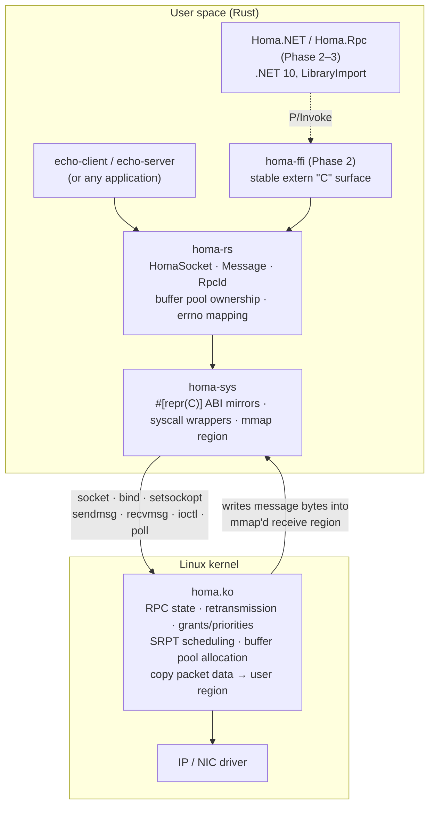

<p align="center">
  
</p>

<p align="center">
  <a href="https://github.com/kearns2000/homastack/actions/workflows/rust-ci.yml"></a>
  <a href="https://github.com/kearns2000/homastack/actions/workflows/dotnet-ci.yml"></a>
  
  <br>
  
  
  
  <a href="https://github.com/PlatformLab/HomaModule/tree/4bd0275714439da2955670a6c438f6c23304d785"></a>
  <a href="LICENSE"></a>
</p>

An open-source, high-performance RPC and networking stack built with Rust and
.NET, powered by the [Homa](https://homa-transport.atlassian.net/wiki/spaces/HOMA)
transport protocol.

Homa is a receiver-driven, message-oriented datacenter transport designed for
low tail latency on small RPCs (SIGCOMM '19, USENIX ATC '21). HomaStack aims to
make it usable from Rust and .NET through a layered design:

| Layer | Crate / package | Status |
|-------|-----------------|--------|
| Kernel transport | Linux `homa` module ([PlatformLab/HomaModule](https://github.com/PlatformLab/HomaModule)) | external dependency |
| Raw bindings | `rust/crates/homa-sys` | **Phase 1 - implemented** |
| Safe Rust API | `rust/crates/homa-rs` | **Phase 1 - implemented** |
| Examples | `rust/examples/echo-server`, `echo-client` | **Phase 1 - implemented** |
| Stable C ABI | `rust/crates/homa-ffi` | placeholder (Phase 2) |
| Managed wrapper | `dotnet/src/Homa.NET` | planned (Phase 2) |
| RPC framework | `dotnet/src/Homa.Rpc`, `Homa.Rpc.Hosting` | planned (Phase 3) |
| Userspace Homa in Rust | - | possible future work |

## Phase 1: what this is

Phase 1 is a **proof of concept that a Rust client and server can exchange RPCs
through the existing Linux Homa kernel module**. It delivers:

- `homa-sys`: hand-written, layout-verified bindings to the socket interface in
  `homa.h` (sockets, `bind`, `SO_HOMA_RCVBUF`/`SO_HOMA_SERVER`, `sendmsg`,
  `recvmsg`, `HOMAIOCRELEASE`/`HOMAIOCINFO`/`HOMAIOCABORT`, `shutdown`, `poll`),
  plus an `mmap` wrapper for the receive-buffer region.
- `homa-rs`: a small synchronous API - `HomaSocket::bind`, `request`, `recv`,
  `reply` - that owns the receive-buffer pool, validates and reassembles
  multi-page messages, recycles buffer pages to the kernel, handles RPC ids
  correctly and maps `errno` to a typed error.
- An echo server and an echo client with round-trip latency statistics.
- Unit tests that run anywhere, and kernel integration tests that run on Linux
  with the module loaded.

It is **not** a reimplementation of the Homa protocol, and it is not
asynchronous. Payloads are copied once out of the kernel-managed region into a
`Vec<u8>`; zero-copy is not claimed.

> **Integration status:** the code was built, linted and unit-tested on macOS
> and cross-checked (`cargo clippy`/`cargo doc`) for `x86_64-unknown-linux-gnu`
> and `aarch64-unknown-linux-gnu`. The kernel integration tests have **not yet
> been executed** against a live Homa module because the development machine
> cannot run it. See [tests/integration/README.md](tests/integration/README.md)
> for the exact procedure and the results log.

## Dependency on the Linux kernel module

Everything in Phase 1 relies on `IPPROTO_HOMA` sockets provided by the
out-of-tree `homa.ko` module. Pinned upstream revision:
`PlatformLab/HomaModule@4bd0275714439da2955670a6c438f6c23304d785` (2026-10-27,
tested upstream on Linux 6.17.8). The user-space header from that revision is
vendored at `rust/crates/homa-sys/upstream/homa.h`.

Homa does **not** work on Windows, macOS, WSL2's stock kernel, ordinary Docker
containers (unless the host kernel has the module), or managed cloud PaaS
services. You need a Linux host (bare metal or a VM with a kernel you control).

## Architecture



Responsibility split:

- **Kernel (`homa.ko`)** - the entire transport protocol: packet formats,
  unscheduled/grant flow control, priorities, retransmission, timeouts, RPC
  state machines, assigning RPC ids, allocating bpages in the user-supplied
  region and copying packet payloads into them.
- **Rust (`homa-sys`/`homa-rs`)** - creating sockets, registering the receive
  region, building the `msghdr`/control blocks exactly as the kernel expects,
  tracking which bpages the application owns and handing them back, validating
  fragment descriptors, reassembling payloads, decoding peer addresses, timeouts
  on top of `MSG_DONTWAIT`/`poll`, and error translation.

More detail in [docs/architecture.md](docs/architecture.md) and
[docs/native-interop.md](docs/native-interop.md).

## Building

Requirements: Rust (the pinned toolchain in `rust/rust-toolchain.toml` is
fetched automatically by `rustup`), a C compiler for the optional header check.

```bash
cd rust
cargo build --workspace            # works on Linux and macOS
cargo test --workspace             # unit tests + doctests, no Homa needed
cargo clippy --workspace --all-targets -- -D warnings
cargo fmt --all --check
cargo doc --workspace --no-deps
```

On Linux you can additionally verify the hand-written ABI against the vendored
header with the system C compiler:

```bash
cargo test -p homa-sys --features header-check
```

## Setting up a compatible Linux environment

Short version (full instructions in [docs/linux-setup.md](docs/linux-setup.md)):

```bash
scripts/check-environment.sh                      # read-only diagnosis
git clone https://github.com/PlatformLab/HomaModule.git
cd HomaModule && git checkout 4bd0275714439da2955670a6c438f6c23304d785
make all                                          # needs kernel headers for the running kernel
sudo insmod homa.ko                               # load (sudo rmmod homa to unload)
```

The scripts in this repository never install or load kernel modules themselves.

## Running the echo server and client

```bash
cd rust
cargo build --release

# terminal 1
./target/release/echo-server --bind 0.0.0.0 --port 5000

# terminal 2
./target/release/echo-client --server 127.0.0.1 --port 5000 --payload "Hello Homa"
./target/release/echo-client --server 127.0.0.1 --port 5000 --iterations 1000
./target/release/echo-client --server 127.0.0.1 --port 5000 --payload-size 300000 --iterations 10
```

Set `RUST_LOG=debug` (or `trace`) for per-message logs. The client exits
non-zero if any response does not match the request. Reported latency is the
user-space round trip (two system calls plus copies), not wire latency.

## Tests

| Command | Needs Homa? | What it covers |
|---------|-------------|----------------|
| `cargo test --workspace` | no | ABI sizes/offsets/ioctl numbers, address conversion, errno translation, fragment layout validation, multi-page reassembly, bpage queue batching, payload rules, latency stats |
| `cargo test -p homa-sys --features header-check` | no (Linux + `cc`) | compiles the vendored `homa.h` and compares every size/offset/constant with the Rust definitions |
| `cargo test -p homa-rs --test kernel_integration -- --ignored --test-threads=1` | **yes** | small RPC, binary payload with NULs, 300 KB / 1 MB multi-page payloads, 200 sequential requests with buffer recycling, completion cookies & shared vs private responses, concurrent requests, no-server and unreachable destinations, receive timeout and shutdown wake-up, cleanup after failures |
| `scripts/run-integration.sh` | **yes** | runs both of the above and writes a log under `tests/integration/results/` |

Integration tests are `#[ignore]`d so `cargo test` never fails just because
Homa is absent, and they are never mocked.

## Known limitations

- Linux only; requires the out-of-tree module. No fallback transport.
- Synchronous API. No async runtime integration yet (the fd and the
  non-blocking primitives are exposed for a future layer).
- One copy per received message (kernel region → `Vec<u8>`). No zero-copy.
- Timeouts for *private* responses are implemented by polling with
  `MSG_DONTWAIT` and exponential back-off (20 µs → 1 ms), because Homa ignores
  `SO_RCVTIMEO` and private responses do not wake `poll(2)`.
- `HOMAIOCABORT` (used after a client timeout) exists in the GitHub module but
  not in the stripped variant prepared for upstream Linux; there the abort is a
  no-op and the RPC lingers until the kernel's own timeout.
- Receive-region minimum size depends on the kernel's `nr_cpu_ids`; the default
  64 MiB region is adequate for typical hosts but the kernel's `EINVAL` (with
  its `error_msg`) is surfaced rather than predicted.
- ioctl numbers are encoded for the asm-generic layout (x86, arm64, riscv, …);
  the crate refuses to build on powerpc/mips/sparc until that encoding is added.
- Kernel interoperability has not been executed yet (see above).

## Upstream projects, revisions and licences

- Linux kernel module: <https://github.com/PlatformLab/HomaModule>, pinned at
  `4bd0275714439da2955670a6c438f6c23304d785`. `homa.h` is
  `BSD-2-Clause OR GPL-2.0+ WITH Linux-syscall-note` and is vendored under the
  BSD-2-Clause option (see `rust/crates/homa-sys/upstream/LICENSE-BSD-2-Clause`).
  Kernel sources and `util/` examples were read, not copied.
- Older userspace C++ transport: <https://github.com/PlatformLab/Homa>, pinned at
  `6f0873de6b1b8cd060c21735c04de1fb9a27c693`, ISC licence. Consulted for
  architecture only; its wire protocol predates the kernel module and was not
  used.
- **HomaStack's own licence has not been chosen yet.** See [LICENSE](LICENSE)
  for the decision that is needed and the constraints from upstream.

## Roadmap: C ABI and .NET

Phase 2 turns `homa-ffi` into a flat, versioned `extern "C"` API (opaque
socket handle, byte-slice in/out, integer error codes plus a last-error string)
built as a `cdylib`, and `Homa.NET` consumes it through `LibraryImport` with a
`SafeHandle`. Phase 3 layers `Homa.Rpc` (serialization, dispatch, cancellation)
and `Homa.Rpc.Hosting` (DI/`IHostedService`) on top. The plan is detailed in
[docs/native-interop.md](docs/native-interop.md).
