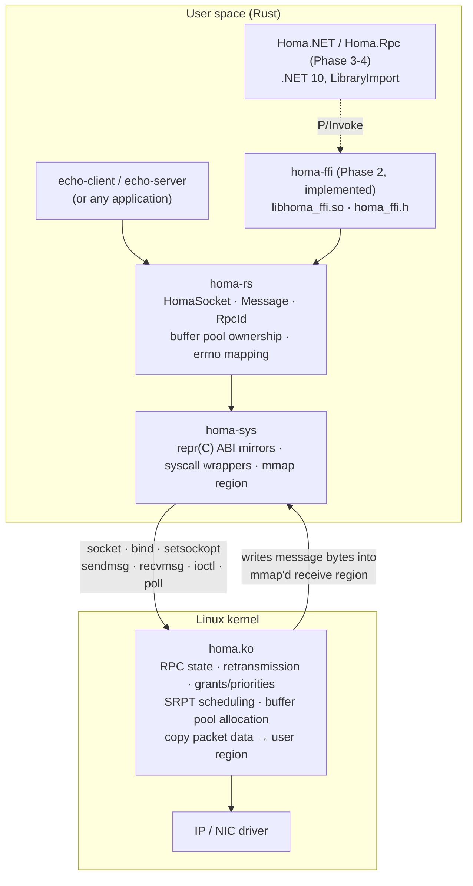

<p align="center">
  
</p>

<p align="center">
  <a href="https://github.com/kearns2000/homastack/actions/workflows/rust-ci.yml"></a>
  <a href="https://github.com/kearns2000/homastack/actions/workflows/dotnet-ci.yml"></a>
  
  <br>
  
  
  
  <a href="https://github.com/PlatformLab/HomaModule/tree/4bd0275714439da2955670a6c438f6c23304d785"></a>
  <a href="tests/integration/README.md"></a>
  <a href="LICENSE"></a>
</p>

An open-source, high-performance RPC and networking stack built with Rust and
.NET, powered by the [Homa](https://homa-transport.atlassian.net/wiki/spaces/HOMA)
transport protocol.

Homa is a receiver-driven, message-oriented datacenter transport designed for
low tail latency on small RPCs (SIGCOMM '19, USENIX ATC '21). HomaStack aims to
make it usable from Rust and .NET through a layered design:

| Layer | Crate / package | Status |
|-------|-----------------|--------|
| Kernel transport | Linux `homa` module ([PlatformLab/HomaModule](https://github.com/PlatformLab/HomaModule)) | external dependency |
| Raw bindings | `rust/crates/homa-sys` | **Phase 1 - implemented** |
| Safe Rust API | `rust/crates/homa-rs` | **Phase 1 - implemented** |
| Examples | `rust/examples/echo-server`, `echo-client` | **Phase 1 - implemented** |
| Stable C ABI | `rust/crates/homa-ffi` (`libhoma_ffi.so`) | **Phase 2 - implemented** |
| Managed wrapper | `dotnet/src/Homa.NET` | **Phase 3 - implemented** |
| RPC framework | `dotnet/src/Homa.Rpc`, `Homa.Rpc.Hosting` | **Phase 4 - implemented** |
| Userspace Homa in Rust | - | possible future work |

## Phase 1: what this is

Phase 1 is a **proof of concept that a Rust client and server can exchange RPCs
through the existing Linux Homa kernel module**. It delivers:

- `homa-sys`: hand-written, layout-verified bindings to the socket interface in
  `homa.h` (sockets, `bind`, `SO_HOMA_RCVBUF`/`SO_HOMA_SERVER`, `sendmsg`,
  `recvmsg`, `HOMAIOCRELEASE`/`HOMAIOCINFO`/`HOMAIOCABORT`, `shutdown`, `poll`),
  plus an `mmap` wrapper for the receive-buffer region.
- `homa-rs`: a small synchronous API - `HomaSocket::bind`, `request`, `recv`,
  `reply` - that owns the receive-buffer pool, validates and reassembles
  multi-page messages, recycles buffer pages to the kernel, handles RPC ids
  correctly and maps `errno` to a typed error.
- An echo server and an echo client with round-trip latency statistics.
- Unit tests that run anywhere, and kernel integration tests that run on Linux
  with the module loaded.

It is **not** a reimplementation of the Homa protocol, and it is not
asynchronous. Payloads are copied once out of the kernel-managed region into a
`Vec<u8>`; zero-copy is not claimed.

> **Integration status:** the code was built, linted and unit-tested on macOS
> and cross-checked (`cargo clippy`/`cargo doc`) for `x86_64-unknown-linux-gnu`
> and `aarch64-unknown-linux-gnu`. The Rust and C ABI kernel tests have since
> passed on a custom WSL2 kernel, `6.18.54.1-microsoft-standard-WSL2+`, with
> `homa.ko` loaded: 10 `homa-rs` tests, 8 `homa-ffi` tests, and both header
> checks. The module was HomaModule `4bd0275` plus a local `recvmsg` change
> required by Linux 6.18; that change is not in this repository. On that same
> host a .NET 10 process loaded `libhoma_ffi.so`, bound a socket, and
> completed a transport request and a `Homa.Rpc` call. See
> [tests/integration/README.md](tests/integration/README.md).

## Dependency on the Linux kernel module

Everything in Phase 1 relies on `IPPROTO_HOMA` sockets provided by the
out-of-tree `homa.ko` module. Pinned upstream revision:
`PlatformLab/HomaModule@4bd0275714439da2955670a6c438f6c23304d785` (2026-10-27,
tested upstream on Linux 6.17.8). The user-space header from that revision is
vendored at `rust/crates/homa-sys/upstream/homa.h`.

Homa does **not** work on Windows, macOS, WSL2's stock kernel, ordinary Docker
containers (unless the host kernel has the module), or managed cloud PaaS
services. You need a Linux host (bare metal or a VM with a kernel you control).

## Architecture



Responsibility split:

- **Kernel (`homa.ko`)** - the entire transport protocol: packet formats,
  unscheduled/grant flow control, priorities, retransmission, timeouts, RPC
  state machines, assigning RPC ids, allocating bpages in the user-supplied
  region and copying packet payloads into them.
- **Rust (`homa-sys`/`homa-rs`)** - creating sockets, registering the receive
  region, building the `msghdr`/control blocks exactly as the kernel expects,
  tracking which bpages the application owns and handing them back, validating
  fragment descriptors, reassembling payloads, decoding peer addresses, timeouts
  on top of `MSG_DONTWAIT`/`poll`, and error translation.
- **C ABI (`homa-ffi`)** - a versioned `extern "C"` adapter over `homa-rs`.
  It does not talk to the kernel itself. C, C++ and .NET consume
  `libhoma_ffi.so` through `include/homa_ffi.h`. `Homa.NET` is that .NET
  consumer. `Homa.Rpc` calls `Homa.NET` and does not define a new native ABI.

More detail in [docs/architecture.md](docs/architecture.md) and
[docs/native-interop.md](docs/native-interop.md).

## Building

Requirements: Rust (the pinned toolchain in `rust/rust-toolchain.toml` is
fetched automatically by `rustup`), a C compiler for the optional header check.

```bash
cd rust
cargo build --workspace            # works on Linux and macOS
cargo test --workspace             # unit tests + doctests, no Homa needed
cargo clippy --workspace --all-targets -- -D warnings
cargo fmt --all --check
cargo doc --workspace --no-deps
cargo build --release -p homa-ffi  # libhoma_ffi.so / .dylib / .a
```

On Linux you can additionally verify the hand-written ABIs against their C
headers with the system C compiler:

```bash
cargo test -p homa-sys --features header-check
cargo test -p homa-ffi --features header-check
```

The native library name is `homa_ffi` (`libhoma_ffi.so` on Linux,
`libhoma_ffi.dylib` on macOS). Only the `homa_*` symbols listed in
`homa_ffi.h` are exported (Linux version script / macOS exported-symbols
list). The native library does not depend on the .NET runtime. `Homa.NET`
loads `homa_ffi` with `LibraryImport` (see [Phase 3](#phase-3-managed-homanet)).

## Setting up a compatible Linux environment

Short version (full instructions in [docs/linux-setup.md](docs/linux-setup.md)):

```bash
scripts/check-environment.sh                      # read-only diagnosis
git clone https://github.com/PlatformLab/HomaModule.git
cd HomaModule && git checkout 4bd0275714439da2955670a6c438f6c23304d785
make all                                          # needs kernel headers for the running kernel
sudo insmod homa.ko                               # load (sudo rmmod homa to unload)
```

The scripts in this repository never install or load kernel modules themselves.

## Running the echo server and client

```bash
cd rust
cargo build --release

# terminal 1
./target/release/echo-server --bind 0.0.0.0 --port 5000

# terminal 2
./target/release/echo-client --server 127.0.0.1 --port 5000 --payload "Hello Homa"
./target/release/echo-client --server 127.0.0.1 --port 5000 --iterations 1000
./target/release/echo-client --server 127.0.0.1 --port 5000 --payload-size 300000 --iterations 10
```

Set `RUST_LOG=debug` (or `trace`) for per-message logs. The client exits
non-zero if any response does not match the request. Reported latency is the
user-space round trip (two system calls plus copies), not wire latency.

The C smoke-test client (`rust/examples/ffi-client`) talks to the same
echo server through `libhoma_ffi.so` and `homa_ffi.h` only:

```bash
cd rust
cargo build --release -p homa-ffi
cmake -S examples/ffi-client -B /tmp/ffi-client-build
cmake --build /tmp/ffi-client-build
/tmp/ffi-client-build/ffi-client --server 127.0.0.1 --port 5000 --payload "Hello Homa"
```


## Tests

| Command | Needs Homa? | What it covers |
|---------|-------------|----------------|
| `cargo test --workspace` | no | ABI sizes/offsets/ioctl numbers, address conversion, errno translation, fragment layout validation, multi-page reassembly, bpage queue batching, payload rules, latency stats, C ABI version/platform/null-arg/error/panic tests |
| `cargo test -p homa-sys --features header-check` | no (Linux + `cc`) | compiles the vendored `homa.h` and compares every size/offset/constant with the Rust definitions |
| `cargo test -p homa-ffi --features header-check` | no (`cc`) | compiles `homa_ffi.h` as C11 and compares sizes, offsets and constants with the Rust `#[repr(C)]` types |
| `cargo test -p homa-rs --test kernel_integration -- --ignored --test-threads=1` | **yes** | small RPC, binary payload with NULs, 300 KB / 1 MB multi-page payloads, 200 sequential requests with buffer recycling, completion cookies & shared vs private responses, concurrent requests, no-server and unreachable destinations, receive timeout and shutdown wake-up, cleanup after failures |
| `cargo test -p homa-ffi --test ffi_kernel -- --ignored --test-threads=1` | **yes** | C ABI against a live module: request/reply, NULs, large payloads, sequential and concurrent RPCs, Rust server + FFI client, timeout/shutdown, handle close |
| `scripts/run-integration.sh` | **yes** | runs the header checks and both ignored kernel suites and writes a log under `tests/integration/results/` |
| `dotnet test dotnet/HomaStack.slnx` | no | `Homa.NET`: struct layout, argument checks, ABI version and status names against `libhoma_ffi`. `Open` returns unsupported platform or unavailable without `homa.ko`. `Homa.Rpc`: frame, dispatch, middleware, cancellation and DI, all in memory with no socket. Set `HOMA_FFI_PATH` if the library is not under `rust/target`. |

`cargo test` never fails just because Homa is absent: the kernel suites are
`#[ignore]`d and are never mocked. `dotnet test` does not exchange an RPC.
Rust and C ABI kernel interoperability has been executed once, and a .NET 10
process on that same host has bound a socket and completed a `Homa.Rpc` call.
See [tests/integration/README.md](tests/integration/README.md). The hosted
service's `StartAsync` calls `HomaRpcServer.Bind` and `RunAsync`, which were
the calls that ran.

## Known limitations

- Linux only; requires the out-of-tree module. No fallback transport.
- The Rust API is synchronous. `Homa.NET` blocks a thread-pool thread for each wait; there is no socket-level async runtime.
- One copy per received message (kernel region to `Vec<u8>`). No zero-copy. `HomaMessage.Payload` views that copy until dispose.
- Timeouts for *private* responses are implemented by polling with
  `MSG_DONTWAIT` and exponential back-off (20 µs to 1 ms), because Homa ignores
  `SO_RCVTIMEO` and private responses do not wake `poll(2)`.
- `HOMAIOCABORT` (used after a client timeout, and by `Homa.NET` / `Homa.Rpc` when a private wait is cancelled) exists in the GitHub module but
  not in the stripped variant prepared for upstream Linux; there the abort is a
  no-op and the RPC lingers until the kernel's own timeout.
- Receive-region minimum size depends on the kernel's `nr_cpu_ids`; the default
  64 MiB region is adequate for typical hosts but the kernel's `EINVAL` (with
  its `error_msg`) is surfaced rather than predicted.
- ioctl numbers are encoded for the asm-generic layout (x86, arm64, riscv, …);
  the crate refuses to build on powerpc/mips/sparc until that encoding is added.
- `Homa.Rpc` uses those same thread-pool waits. Its unit tests call an in-memory transport and do not open a socket.
- Rust, C ABI, and .NET socket interoperability has been executed on one custom WSL2 kernel (see [tests/integration/README.md](tests/integration/README.md)). Hosted `StartAsync` is that same `HomaRpcServer.Bind` and `RunAsync`.

## Upstream projects, revisions and licences

- Linux kernel module: <https://github.com/PlatformLab/HomaModule>, pinned at
  `4bd0275714439da2955670a6c438f6c23304d785`. `homa.h` is
  `BSD-2-Clause OR GPL-2.0+ WITH Linux-syscall-note` and is vendored under the
  BSD-2-Clause option (see `rust/crates/homa-sys/upstream/LICENSE-BSD-2-Clause`).
  Kernel sources and `util/` examples were read, not copied.
- Older userspace C++ transport: <https://github.com/PlatformLab/Homa>, pinned at
  `6f0873de6b1b8cd060c21735c04de1fb9a27c693`, ISC licence. Consulted for
  architecture only; its wire protocol predates the kernel module and was not
  used.
- HomaStack itself is [MIT](LICENSE), copyright Patrick Kearns. The vendored
  `homa.h` and its man pages stay under the BSD-2-Clause notice above and are
  not relicensed.

## Phase 2: native C ABI

Phase 2 is a **stable, versioned C ABI over the existing `homa-rs` transport**.
It is an interoperability adapter, not a second transport. The public contract
is `rust/crates/homa-ffi/include/homa_ffi.h`; the Linux shared library is
`libhoma_ffi.so`. ABI version `1`. The implementation is synchronous. See
[docs/native-interop.md](docs/native-interop.md) for every exported function,
ownership rules, error codes, and the .NET `LibraryImport` mapping.

Kernel interoperability of this layer has been executed on the same host as
Phase 1 (see [tests/integration/README.md](tests/integration/README.md)). The
`examples/ffi-client` binary was not built in that run; the `homa-ffi` kernel
tests cover the exported C ABI.

## Phase 3: managed Homa.NET

Phase 3 is a **.NET 10 wrapper over `libhoma_ffi`**. The RPC framework
(`Homa.Rpc` and `Homa.Rpc.Hosting`) is Phase 4, below. Public types live in the
`Homa` namespace: `HomaSocket`, `HomaClient`, `HomaMessage` and
`HomaException`. Sockets and messages are `SafeHandle`s. Payloads are spans
over bytes the native stack already copied.

`RequestAsync` and `RecvResponseAsync` block a thread-pool thread for the
wait, one wait per call, so different private RPC ids can proceed together.
Cancelling the token calls `homa_abort_rpc` for that id. A shared `RecvAsync`
has no id to abort.

```bash
cd rust && cargo build --release -p homa-ffi
cd ../dotnet
export HOMA_FFI_PATH="$PWD/../rust/target/release/libhoma_ffi.so"   # .dylib on macOS
dotnet test HomaStack.slnx
```

```csharp
using System.Net;
using Homa;

using var client = new HomaClient();
using var response = client.Request(
    new IPEndPoint(IPAddress.Parse("127.0.0.1"), 5000),
    "Hello Homa"u8);
```

On a machine without `homa.ko` the tests check layout, argument validation,
ABI version 1 and a failed `Open` (`UnsupportedPlatform` on Windows and macOS,
`Unavailable` on Linux without the module). Rust and C ABI RPCs use the
ignored kernel tests, which have been run once (see the integration log).
On that same host a .NET 10 process has opened a socket and completed a
`Homa.Rpc` call. Hosted `StartAsync` is that same bind and receive loop.

## Phase 4: Homa.Rpc

Phase 4 is an **RPC layer on `Homa.NET`**. It does not add native symbols and
it does not speak to the kernel itself. A call is a Homa request whose payload
is a version-1 frame: ASCII `HOMA`, method name, status and the serializer
bytes. `BytesRpcSerializer` carries a string or a `byte[]`. `JsonRpcSerializer`
uses UTF-8 JSON with camelCase property names.

`HomaRpcClient.CallAsync` cancels through `Homa.NET`, which aborts that private
RPC. A timeout is `RpcStatus.Timeout`, not cancellation. A null timeout waits
30 seconds (`HomaRpcClient.DefaultCallTimeout`); `Timeout.InfiniteTimeSpan`
waits without a deadline. `HomaRpcServer` runs each handler on the thread pool,
at most 128 at a time, and replies to shared receives. A reply the transport
rejects is counted and raised on `TransportFailed`. Stopping the server calls
`Shutdown` because a shared receive has no id to abort. If the receive loop
fails, the hosted service logs it and stops the host. Middleware runs
outside-in. The response is serialized before the per-call DI scope is
disposed, and request logging records that outcome. `Homa.Rpc.Hosting`
registers the pipeline in DI and runs the server as an `IHostedService`.

```csharp
using System.Net;
using Homa.Rpc;

var pipeline = new RpcPipelineBuilder()
    .Map<string, string>("echo", (text, _) => new ValueTask<string>(text))
    .Build(new BytesRpcSerializer());

await using var server = HomaRpcServer.Bind(
    new IPEndPoint(IPAddress.Any, 4000), pipeline);
```

`Bind` and `HomaRpcCaller.Open` need Linux with `homa.ko`. The tests never call
them: they pass an in-memory `IRpcCaller` into `HomaRpcClient` and dispatch
frames on `RpcPipeline` directly. No RPC has been exchanged through the kernel.

A userspace Homa transport, without `homa.ko`, is still future work.
Details of the native contract underneath this layer are in
[docs/native-interop.md](docs/native-interop.md).

## Contributing

See [CONTRIBUTING.md](CONTRIBUTING.md). This project follows the [Code of Conduct](CODE_OF_CONDUCT.md). Security reports go through [SECURITY.md](SECURITY.md).

## Licence

MIT. See [LICENSE](LICENSE). The vendored Homa header remains BSD-2-Clause.
