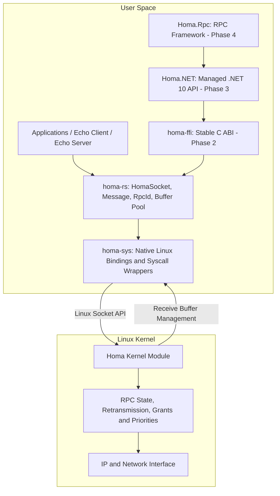
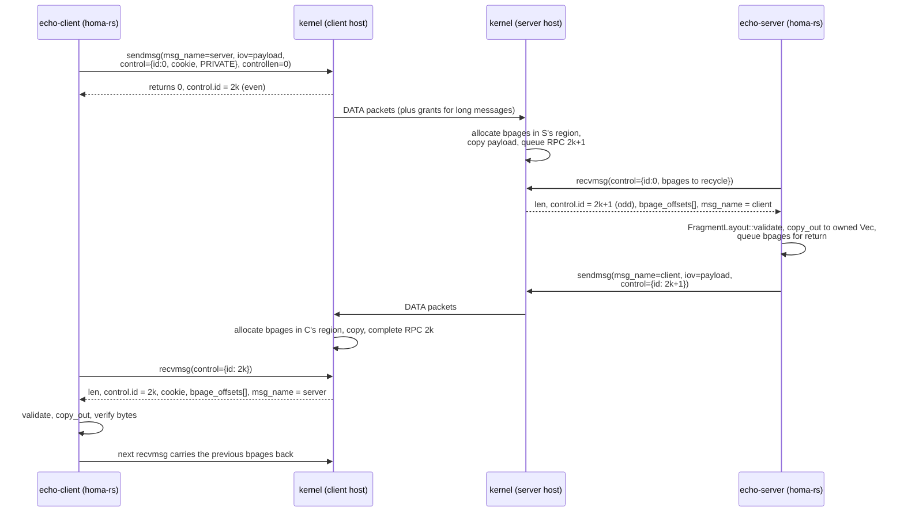

# HomaStack architecture (Phases 1 and 2)

## Layers

The Rust transport integrates directly with the existing Linux Homa kernel
module through its socket API. The .NET components (Phase 3+) consume the Rust
transport through the Phase 2 C ABI; they never talk to the kernel themselves.

| Component | Language | Responsibility |
|---|---|---|
| homa-sys | Rust | Low-level Linux Homa socket bindings and native interoperability |
| homa-rs | Rust | Safe Rust API, RPC messages, buffer ownership and error handling |
| homa-ffi | Rust | Stable C ABI (`libhoma_ffi.so`, ABI 1) exposing the Rust transport to C, C++ and .NET |
| Homa.NET (planned) | C# / .NET 10 | Managed transport API, native handles, asynchronous operations and cancellation |
| Homa.Rpc, Homa.Rpc.Hosting (planned) | C# / .NET 10 | RPC clients, handlers, serialization, middleware and observability; `Hosting` adds DI and `IHostedService` integration |
| Homa kernel module | C / Linux | Wire protocol, reliability, grants, packet scheduling and congestion control |

`homa-sys`, `homa-rs`, the echo examples and `homa-ffi` (ABI version 1, plus
the C `ffi-client` example) are implemented. `Homa.NET` (Phase 3) and
`Homa.Rpc` / `Homa.Rpc.Hosting` (Phase 4) have no code yet. Kernel
interoperability of both Phase 1 and Phase 2 remains unverified until the
ignored tests are run on a Linux host with `homa.ko`.

### Integration flow

Two application paths are intended:

- **Rust application:**
  Rust Application → homa-rs → homa-sys → Linux Homa kernel module → Network
- **.NET application:**
  .NET Application → Homa.Rpc → Homa.NET → homa-ffi → homa-rs → homa-sys →
  Linux Homa kernel module → Network

In both paths the Linux Homa kernel module is an **external dependency**
maintained by the upstream Homa project
([PlatformLab/HomaModule](https://github.com/PlatformLab/HomaModule)); it must
be built and loaded separately (see `linux-setup.md`). HomaStack does not
implement the Homa wire protocol. The Rust crates only drive the module's
socket interface: they create sockets, register the receive region, build the
`sendmsg`/`recvmsg` control blocks, track and return buffer pages, and
translate results into Rust types. Everything on the wire is the kernel's job
(see "What stays in the kernel" below).

### `homa-sys`

- `abi.rs`: `#[repr(C)]` structs and constants transcribed from the pinned
  `homa.h`, with compile-time `size_of`/`offset_of` assertions and the ioctl
  request numbers computed with the asm-generic `_IOC` encoding. Platform
  independent, so it compiles and is unit-tested on macOS too.
- `region.rs`: `MappedRegion`, an RAII anonymous `mmap` used as the receive
  pool. Unix.
- `sys.rs`: one safe function per kernel entry point (`socket`, `bind`,
  `set_rcvbuf_region` (unsafe), `set_server`, `sendmsg`, `recvmsg`,
  `release_bpages`, `info`, `abort`, `shutdown`, `poll_readable`). Linux only.
  Every `unsafe` block carries a `SAFETY:` comment; `unsafe_op_in_unsafe_fn`
  is denied workspace-wide.
- `tests/header_check.rs` (feature `header-check`): compiles the vendored
  header with `cc` and compares every number with the Rust side.

### `homa-rs`

- `transport.rs`: `RpcId` (parity rules: odd = server side/request, even =
  client side/response), `MessageKind`, `Message` (owned payload, peer,
  cookie, fragment count).
- `addr.rs`: `SocketAddr` ⇄ `sockaddr_in`/`sockaddr_in6`, family matching,
  resolution.
- `buffer.rs`: `ReceiveBuffer` (owns the region), `FragmentLayout`
  (validates the kernel's `bpage_offsets` for a given length *before* any
  memory is touched: count = ⌈len/64 KiB⌉, non-final fragments aligned, all
  inside the region, no overlap), `copy_out` (the only reader of the region),
  `BpageQueue` (pages owned by the application awaiting return).
- `error.rs`: `HomaError` (keeps the `io::Error`, adds Homa's `error_msg`
  when the kernel supplies one) and `ErrorKind` classification of `errno`.
- `socket.rs`: `HomaSocket`. Creation order: map region → `socket()` →
  `bind()` → `SO_HOMA_RCVBUF` → `SO_HOMA_SERVER` → `HOMAIOCINFO` (actual
  port). Drop order: release pending bpages → close fd → unmap.

### `homa-ffi`

Adapter only: every call is forwarded to `homa-rs`. Nothing here implements
the wire protocol or issues its own syscalls.

- `types.rs`: `#[repr(C)]` structs (`homa_endpoint_t`, options, info,
  message info) and the integer status codes. Layouts pinned by
  `const` assertions and re-checked against `include/homa_ffi.h`.
- `errors.rs`: `HomaError` → status mapping, thread-local last error,
  panic boundary (`catch_unwind` → `HOMA_ERR_INTERNAL`).
- `handles.rs`: generation-checked socket registry. `homa_socket_t *` is a
  key, never a dereferenceable pointer; close-then-use is
  `HOMA_ERR_INVALID_ARGUMENT`.
- `messages.rs`: `Box<homa_rs::Message>` handed to C; payload pointer
  stable until `homa_message_free`. Copied, not zero-copy.
- `api.rs`: the `extern "C"` exports. Linux implementation calls
  `HomaSocket`; other platforms return `HOMA_ERR_UNSUPPORTED_PLATFORM`.
- `include/homa_ffi.h`: public C11 header. Linux builds of the cdylib
  export only these symbols (`homa_ffi.map`).

The C example `rust/examples/ffi-client` is the first consumer. Phase 3
`Homa.NET` will be the second.

## Message flow

## Ownership of receive buffers

1. `ReceiveBuffer::new` maps N × 64 KiB (default 64 MiB), zeroed, page aligned.
2. `set_rcvbuf_region` hands it to the kernel. From now on the kernel may
   write anywhere in it. Rust never creates a `&[u8]` into it except
   transiently in `copy_out`, and only over bpages the kernel just assigned to
   this thread's message.
3. After a successful `recvmsg`, the listed bpages belong to the application.
   `recv_raw` validates the layout, copies the payload, and pushes the offsets
   into `BpageQueue` - on *every* path, including validation failure.
4. The next `recvmsg` on the socket (any thread) carries up to 16 of those
   offsets back in `num_bpages`/`bpage_offsets`. The kernel frees them before
   it waits, even if the wait then fails with `EINTR`/`EAGAIN`, and reports
   `num_bpages = 0` on every error path (the pinned `homa_recvmsg` zeroes it
   before checking the free's result, contrary to what `recvmsg.2` says).
   `recv_raw` still re-queues offsets if a kernel ever reports
   `num_bpages != 0` on error, and logs a warning when a release is rejected
   with `EINVAL`, which can only be caused by a bookkeeping bug in this crate.
5. `release_pending()` or `Drop` returns anything left via `HOMAIOCRELEASE`.
   `Drop` then closes the fd, and only then unmaps the region, so the kernel
   never references freed memory.

A `Message` therefore never aliases the region and has no lifetime parameter.
The cost is one copy per message; that is the documented Phase 1 trade-off.

## Threading

`HomaSocket` is `Send + Sync`; all methods take `&self`. The only shared
mutable state is the bpage queue behind a `Mutex`. Multiple threads can block
in `recv` simultaneously (the kernel hands each ready RPC to exactly one
waiter) and others can send concurrently. Each receive uses its own
`homa_recvmsg_args` on the stack, so there is no cross-thread sharing of
kernel-visible structures.

## Why synchronous first

Homa's `recvmsg` is already message-granular and `sendmsg` returns once the
message is queued, so a blocking API maps directly onto the kernel calls and
has no hidden state machine. The socket exposes `AsFd`, `try_recv`,
`recv_timeout` and `poll_readable`; an async layer can register the fd with
an reactor (shared messages) and use a small poller task for private responses
without changing `Message`, `RpcId` or the buffer ownership model.

## What stays in the kernel

Packet formats, unscheduled bytes and grants, priority assignment, pacing,
retransmission and timeouts, RPC id allocation, server-side RPC bookkeeping
until the response is acknowledged, bpage allocation inside the region, and
the copy from packet buffers into the region. See upstream `protocol.md` and
the man pages vendored in `rust/crates/homa-sys/upstream/`.
